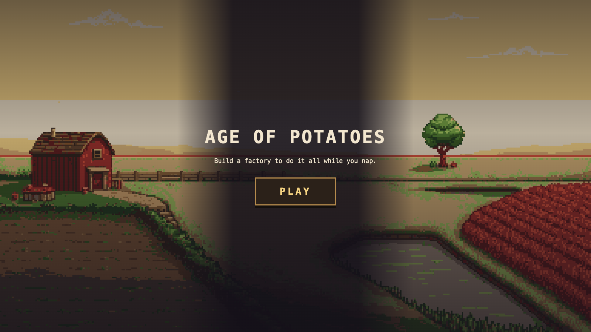
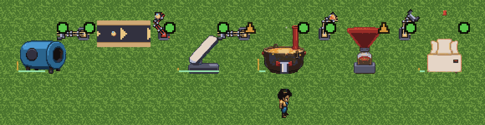
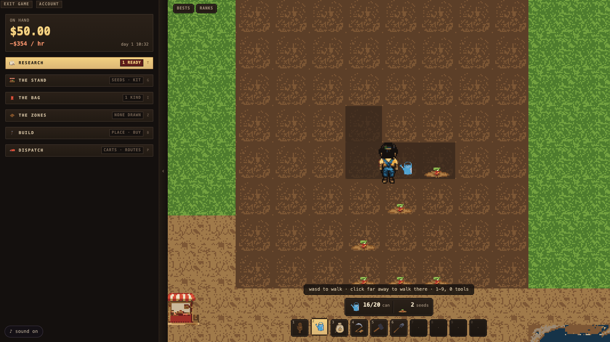
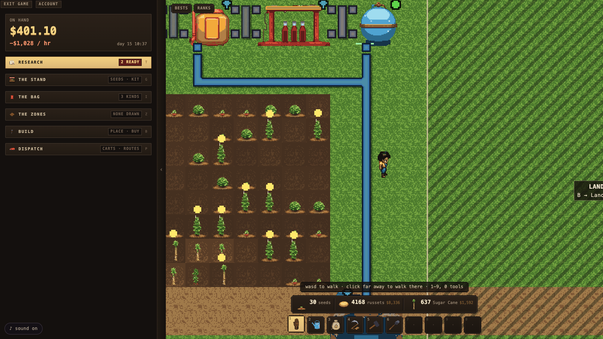
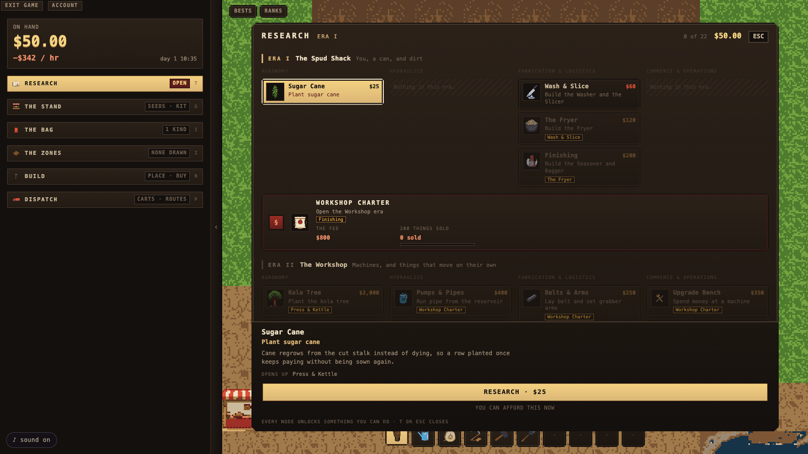
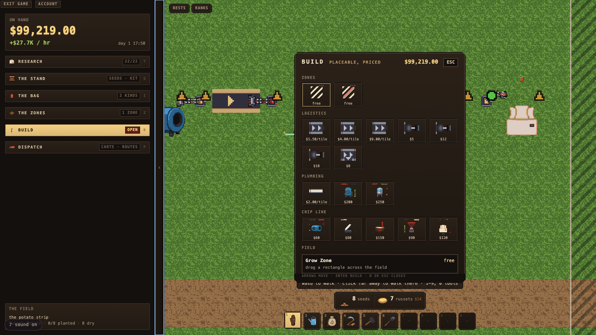
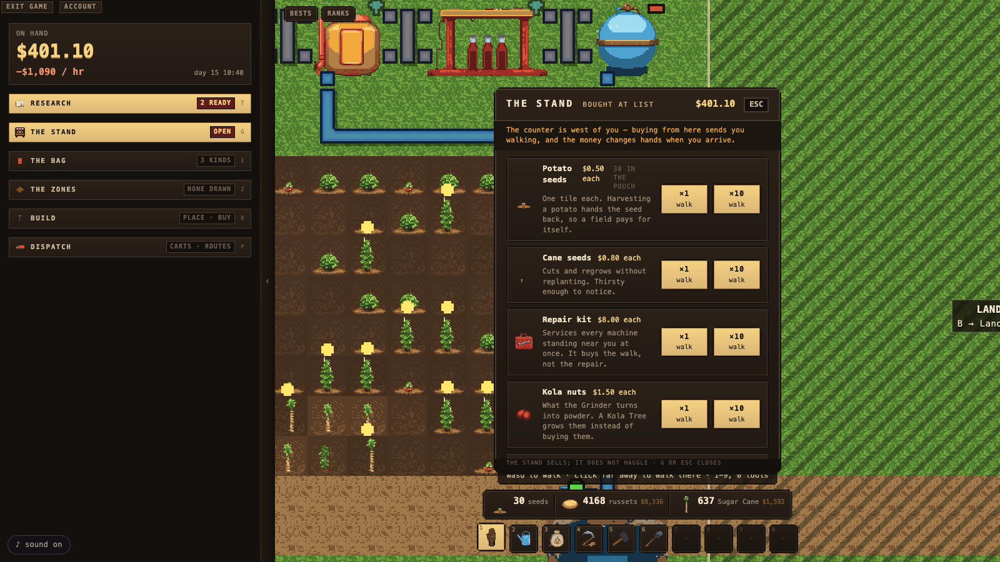
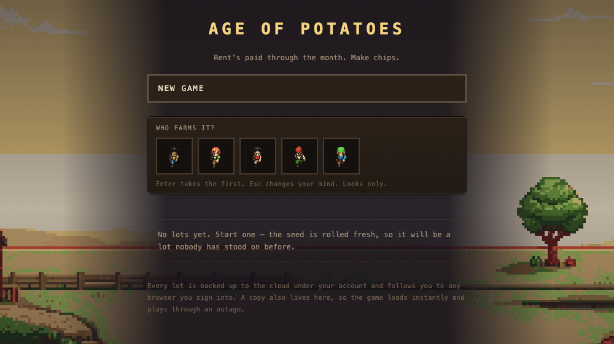

<div align="center">

<a href="https://ageofpotatoes.com"></a>

# 🥔 Age of Potatoes

**Build a chips-and-soda empire from a weedy roadside lot.**

_Factorio × Stardew Valley × RimWorld, in your browser._

### [▶ Play now at ageofpotatoes.com](https://ageofpotatoes.com)

Free, in your desktop browser, nothing to install. Sign in with an email link and your lot
follows you everywhere.

[](https://ageofpotatoes.com)

[](https://github.com/melucasleite/age-of-potatoes/actions/workflows/ci.yml)


</div>

<p align="center">
  <a href="https://ageofpotatoes.com"></a>
  <br />
  <sub><i>Washer → belt → Slicer → Fryer → Seasoner → Bagger. Five grabber arms, zero hands.
  The farmer is supervising.</i></sub>
</p>

---

You start with **$50**, a watering can, a bag of eight seed potatoes, and a patch of dirt.
You end with a humming floor of belts, pipes, and robot arms that grows, fries, seasons,
bags, bottles, and ships while you go make a sandwich.

The loop never changes: **Tend → Convert → Sell → Improve**. What changes over the life of
a save is _who does each verb_. First your hands, then your tools, then your machines.
Every system has a manual tier, an assisted tier, and an automated tier, and every
automation unlock retires a tool with a small ceremony. Your first watering can ends up
bronzed on a plaque, engraved with the number of tiles you personally watered.

> Rent's paid through the month. Make chips.

## From dirt to dynasty

<table>
  <tr>
    <td width="50%" valign="top">
      
      <p><b>Day one — by hand.</b> Press <kbd>3</kbd> and click the dirt to plant a russet,
      <kbd>2</kbd> to water it. Harvesting a potato hands the seed back, so a field pays for
      itself. Everything you do here, you will one day pay a machine to do instead.</p>
    </td>
    <td width="50%" valign="top">
      
      <p><b>Day fifteen — the plumbing arrives.</b> A pump on the pond, pipe running up to
      the machines, and sugar cane that regrows from the cut stalk. Along the top, the soda
      line: cane pressed, boiled down, mixed, carbonated, and bottled.</p>
    </td>
  </tr>
</table>

**Nothing rots.** No crop wilts, no good spoils, and dirt is just dirt. It's a sandbox.
Prices are stable and posted, and the pressure comes from upkeep instead: machines wear
with use, and a sloppy factory bleeds margin. A well-run one prints money and, because
every machine's work-cycle sound is quantized to a shared beat grid, **it literally
grooves.**

## Three eras, twenty-two discoveries



The research atlas lays the whole climb out in front of you, four lanes wide: Agronomy,
Hydraulics, Fabrication & Logistics, and Commerce & Operations. Each era is sealed by a
**charter**: pay the fee _and_ prove you've earned it before the next one opens.

| Era     | Name                  | The vibe                                      | You unlock                                                                   |
| ------- | --------------------- | --------------------------------------------- | ---------------------------------------------------------------------------- |
| **I**   | **The Spud Shack**    | _You, a can, and dirt_                        | Sugar cane, the Washer & Slicer, the Fryer, the Seasoner & Bagger            |
| **II**  | **The Workshop**      | _Machines, and things that move on their own_ | Belts & grabber arms, pumps & pipes, irrigation, the soda line, bots, trucks |
| **III** | **The Assembly Line** | _A floor that runs without you_               | Express belts, long-reach arms, repair drones                                |

## Build anything, buy everything

<table>
  <tr>
    <td width="50%" valign="top">
      
      <p><b>The Build menu</b> (<kbd>B</kbd>). Three belt tiers, filtered and long-reach arms,
      junctions, pipe, pumps, sprinklers, and every machine on the line, each with its
      price on the tag.</p>
    </td>
    <td width="50%" valign="top">
      
      <p><b>The Stand</b> (<kbd>G</kbd>). Seeds, repair kits, kola nuts. The counter is a
      real place on your lot: buying sends you walking, and the money changes hands when
      you arrive. <i>The stand sells; it does not haggle.</i></p>
    </td>
  </tr>
</table>

<details>
<summary><b>⌨️ Controls</b></summary>

| Key                         | Does                                          |
| --------------------------- | --------------------------------------------- |
| <kbd>W A S D</kbd> / click  | Walk (click somewhere far away to walk there) |
| <kbd>1</kbd>–<kbd>0</kbd>   | Pick a tool from the hotbar                   |
| <kbd>B</kbd>                | Build menu                                    |
| <kbd>T</kbd>                | Research                                      |
| <kbd>G</kbd>                | The Stand                                     |
| <kbd>I</kbd>                | The Bag                                       |
| <kbd>Z</kbd>                | Zones                                         |
| <kbd>P</kbd>                | Dispatch: carts and truck routes              |
| <kbd>R</kbd>                | Rotate the ghost, or the arm under the cursor |
| <kbd>C</kbd> / <kbd>L</kbd> | Cycle the crop / the liquid for a pipe run    |
| <kbd>+</kbd> / <kbd>−</kbd> | Zoom                                          |
| Right-click                 | Tear down                                     |
| <kbd>Esc</kbd>              | Close whatever's open, or pause               |
| <kbd>F3</kbd>               | Perf overlay                                  |

</details>

## Every lot is yours, everywhere

<p align="center"></p>

Sign in with an email magic link, pick your farmer, and roll a fresh seed: a lot nobody
has stood on before. Every lot is backed up to the cloud under your account and follows you
to any browser. A copy also lives locally in IndexedDB, so the game **boots instantly and
plays straight through a network outage**. Personal bests and a global leaderboard are a
click away.

## Under the hood

This is a hobby game built with a level of engineering paranoia normally reserved for
flight software. The highlights:

- **🎯 A bit-exact deterministic simulation.** `packages/sim` is pure TypeScript with zero
  dependencies and no DOM. `Date`, `Math.random`, `async`, `for...in`, and every
  transcendental (`sin`, `cos`, `exp`, `pow`, `**`…) are banned in there, because JS engines
  disagree in the last bits and that desyncs replays. IEEE-754 guarantees `+ − × ÷` and
  `sqrt`. Nothing else gets in.
- **🔢 Integers all the way down.** 256 subtiles per tile, money in cents, machine progress
  in work-points, fluids in millilitres. There are no floats in sim state, so a refactor
  that reorders `(a*b)+c` can't silently invalidate every stored replay.
- **🧪 Golden replays on every push.** Twenty pinned worlds (a seed, a frozen command list,
  a tick count, and the state hash they must produce) replay headless in CI. The day
  someone introduces non-determinism is the day the build goes red. One of those worlds
  runs **272,000 ticks**.
- **📜 Every mutation is a `Command` at a tick.** No debug buttons, no out-of-band writes.
  Even the cheat console is a command, and it's counted and hashed (cheated saves stay off
  the public leaderboard).
- **🎨 The renderer is a one-way street.** Interpolated positions, particle jitter, and lamp
  flicker live in `apps/web` and are never read back. Audio follows the sim's integer beat
  grid. `AudioContext.currentTime` never touches the simulation.
- **🖼️ An AI art pipeline with a hard budget.** `yarn art` generates pixel art (Retro
  Diffusion, with OpenAI as fallback), locks it to a master palette, and packs the atlas.
  It **fails the build** if the belt-item atlas spills onto a second texture page, because
  PixiJS's `ParticleContainer` needs one shared texture.

**Stack:** Next.js 16 (App Router, Turbopack) · React 19 · PixiJS 8 as a library, no game
framework · TypeScript 6 · Vitest 4 · Supabase (auth + cloud saves) · yarn 1 workspaces ·
~118k lines of TypeScript across 92 test files.

## Getting started

> **Just want to play?** You don't need any of this. The live game is at
> **[ageofpotatoes.com](https://ageofpotatoes.com)**. The steps below are for running your own copy.

```bash
yarn install
yarn build
```

Accounts are required, so the game needs a Supabase project. Copy
`apps/web/.env.example` to `apps/web/.env.local` and fill in `NEXT_PUBLIC_SUPABASE_URL`
and `NEXT_PUBLIC_SUPABASE_PUBLISHABLE_KEY`. Without them, `/play` shows a "cloud is not
configured" screen instead of the game. The dashboard switches the code depends on are
listed in [`supabase/README.md`](supabase/README.md).

Then run your dev server and open `/play`.

| Command          | Does                                             |
| ---------------- | ------------------------------------------------ |
| `yarn typecheck` | `tsc --build` across the workspace               |
| `yarn test`      | Vitest, including the golden determinism replays |
| `yarn lint`      | The lint rules that enforce sim purity           |
| `yarn format`    | Prettier (run it after any change)               |
| `yarn art gen`   | Generate art (`--dry-run` first, it's free)      |
| `yarn art pack`  | Post-process and pack the atlas                  |

## Layout

| Path               | What lives there                                                          |
| ------------------ | ------------------------------------------------------------------------- |
| `packages/sim`     | The deterministic simulation. Pure TypeScript, zero dependencies, no DOM. |
| `packages/art-cli` | Asset pipeline: AI generation → post-processing → atlas packing.          |
| `apps/web`         | Next.js shell, PixiJS renderer, input, HUD, audio.                        |
| `art/`             | Master palette, manifest, and committed generated originals.              |
| `supabase/`        | Migrations and the dashboard checklist for accounts and cloud saves.      |

## Contributing

Read [AGENTS.md](AGENTS.md) first. It documents the rules that are load-bearing rather
than stylistic, and each one is there because breaking it fails silently.

And remember the design gate that outranks everything else in this repo: **a fresh-eyes
player should grin the moment the sprinkler waters for them, then immediately want a
second one.** If a change makes the manual farming less pleasant, it's a regression, no
matter what it optimizes.

<div align="center">

### 🥔 [Go make chips →](https://ageofpotatoes.com)

</div>

## License

[MIT](LICENSE) © 2026 Lucas Leite

---

<sub>Screenshots were captured headlessly with Playwright against a production build. The
busy worlds are the sim's own golden fixtures, replayed and loaded as saves, so every
machine in them was placed by a real command on a real tick.</sub>
