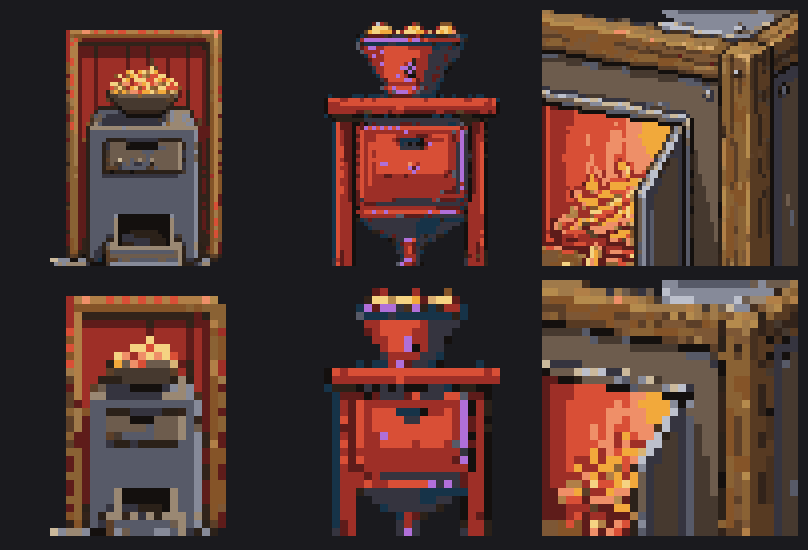
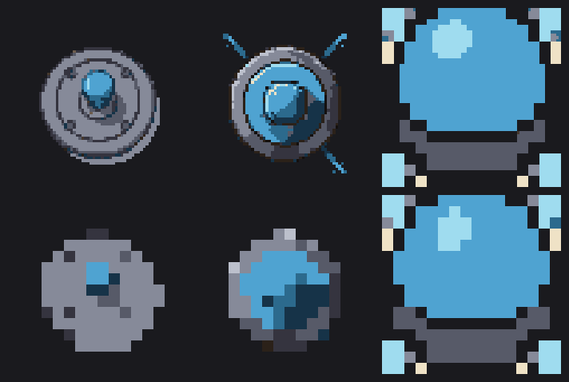
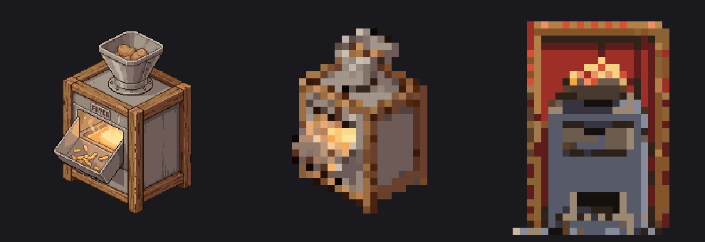

# Retro Diffusion pricing — measured, not remembered

A spike (work item 048, 2026-08-12) run against the live API to settle one question. The
project had been operating on an **inferred** conclusion: that consistent house-style art
requires RD Pro at a flat $0.18/image — roughly 10× the `rd_fast` floor — and that a full
v1.0 catalogue therefore costs **$150–400**.

**Verdict: the mechanism was right, the conclusion was wrong, and the reason is not the one
anybody expected.** Custom saved styles really are billed at the Pro rate, and there really is
no cheap way to feed RD reference images. But it does not matter, because **Pro's output is
unusable at the sizes this game ships.** Two independent assets came back from Pro as
frame-filling painterly crops with no background removal — not sprites. The $0.017 `rd_fast`
sprite is *visibly better* at 32px than the $0.18 Pro one, not merely indistinguishable.

Realistic v1.0 catalogue cost: **$10–20**, and the current balance already covers it several
times over.

`check_cost: true` is free and generates nothing, so the entire pricing surface was mapped for
**$0.00**. Only the visual comparison cost money: **$0.91 total**, against a $3.00 cap.

---

## 1. The pricing formula

Cost is **affine in pixel area**, per model — a base fee plus a per-pixel rate, rounded to
three decimals. Not tiered, not stepped.

| Model     | Formula                     | Effective floor | Fit quality |
| --------- | --------------------------- | --------------- | ----------- |
| `rd_fast` | `$0.0166 + $0.1665 per Mpx` | **$0.017**      | 13/13 exact |
| `rd_plus` | `$0.0250 + $0.4985 per Mpx` | **$0.025**      | 16/16 exact |
| `rd_pro`  | **`$0.18`, constant**       | $0.18           | 17/17 exact |

Measured grid (square, `num_images: 1`):

| size | `rd_fast` | `rd_plus` | `rd_pro` |
| ---- | --------- | --------- | -------- |
| 16   | 0.017     | 0.025     | **0.18** |
| 32   | 0.017     | 0.026     | **0.18** |
| 48   | 0.017     | 0.026     | **0.18** |
| 64   | 0.017     | 0.027     | **0.18** |
| 96   | 0.018     | 0.030     | **0.18** |
| 128  | 0.019     | 0.033     | **0.18** |
| 192  | 0.023     | 0.043     | **0.18** |
| 256  | 0.028     | 0.058     | **0.18** |
| 384  | 0.041     | 0.099     | **0.18** |
| 512  | 0.060     | 0.156     | **0.18** |

**Pro is genuinely flat-rate regardless of size — confirmed, 16px through 512px.** That part of
the prior conclusion fully survives. It also means Pro is at its _worst_ value exactly where
this project lives: at 64px Pro costs **10.6× `rd_fast`**; at 512px only 3×. Pro is priced for
people generating big images.

**There is no separate "price floor" mechanism.** The floor is just the base fee dominating.
Where does area pricing start to bite? Taking "bite" as the area term equalling the base fee:

- `rd_fast`: **~316×316** (99,700 px²)
- `rd_plus`: **~224×224** (50,150 px²)

Every asset here is requested at 64–96px, so **area pricing is irrelevant to us** — the
difference between a 64px and a 96px request is **$0.001**.

### Secondary pricing facts

- **Cost tracks total area only, never aspect ratio.** 64×256, 256×64 and 128×128 all price the
  same; 96×384 and 192×192 (both 36,864 px²) both cost $0.023. Wide strips carry no penalty,
  which matters because the crop-growth-strip trick depends on them.
- **`num_images` multiplies exactly.** `rd_fast` 64px: n=1 → $0.017, n=2 → $0.035, n=4 → $0.069,
  n=10 → $0.173. No batch discount, no batch penalty.
- **The `model` field is a different axis** accepting only `RD_CLASSIC` and `RD_FLUX`. Neither
  changes price, and neither can force a saved style onto a cheaper tier.

---

## 2. What styles this account actually has

There is **no listing endpoint**. `GET /v1/styles` is 405; `POST /v1/styles` is the _creation_
endpoint. Styles were enumerated by probing names — a valid one prices, an unknown one **500s**
(confirming the README's note that a 500 usually means an unknown `prompt_style`).

**30 built-in styles across 3 families:**

- **`rd_fast__`** ($0.017 @64px) — `default`, `retro`, `simple`, `detailed`, `game_asset`,
  `portrait`, `texture`, `ui`, `item_sheet`, `mc_texture`, `mc_item`, `character_turnaround`,
  `1_bit`, `no_style`, `low_res`
- **`rd_plus__`** ($0.027 @64px) — `default`, `retro`, `item_sheet`, `mc_texture`\*, `mc_item`\*,
  `character_turnaround`, `1_bit`, `no_style`, `low_res`\*, `isometric`, `watercolor`, `cartoon`
- **`rd_pro__`** ($0.18 flat) — `default`, `simple`, `isometric`

\* these three price at $0.030 rather than $0.027 at 64px, implying a larger internal render.

Bare family names (`rd_fast` with no `__suffix`) are **not** valid styles.

---

## 3. Do custom saved styles require Pro? Yes, to use — and there is no cheap substitute

**Creating one is free and needs no Pro tier.** `POST /v1/styles` with
`{ name, reference_images: [<base64 png>] }` returned **201** immediately on this account, no
upsell, no tier error, **no charge**. The only validation is "User styles must include at least
one reference image." The field is `reference_images`; `images`, `input_images`, `style_images`
and `image` are all rejected.

**Consuming one costs the Pro rate.** The returned `user__<name>_<hash>` style prices at
**$0.18 flat at every size** — 64, 128, 256, 384, all $0.18. Passing `model` only accepts
`RD_CLASSIC`/`RD_FLUX`; a `base_style` hint is ignored. There is no cheaper path.

### The cheap consistency lever does not exist — this was tested and it failed

The obvious hope was to skip the saved style and pass `reference_images` directly on a
`rd_fast` call. It appears to work: the request returns 200 and bills $0.017, no premium.

**It is a mirage.** Six real paid generations, same prompt and seed, differing only in
reference images and `strength`, came back **byte-for-byte identical** (SHA-256 verified, two
groups of three). A warm red/wood reference and a cool blue/grey reference produced pixel-
identical output — mean RGB identical to the unit, identical opaque-pixel counts.

The reason: **`/v1/inferences` silently accepts and ignores arbitrary unknown fields.** Sending
`xyzzy_not_a_real_field`, `please_ignore_me` or `banana` all return a cheerful 200 at $0.017.
By contrast `/v1/styles` has a strict schema and rejects `banana` with "extra fields not
permitted." So `reference_images` is simply **not a parameter of the inference endpoint** — it
was never being applied, only swallowed.

**So the prior agent's mechanism claim is confirmed:** reference-image style consistency is
available only through a saved style, and a saved style costs $0.18 per image. There is no
$0.017 version of it.

**`input_palette` is likewise accepted everywhere at no cost — but recall work item 005 found
RD treats it as a guide only** (output came back systematically −1 in the red channel), so
`quantizeToPalette` does the real palette work locally regardless of tier. A more expensive
model therefore buys nothing on the palette axis either.

---

## 4. Is Pro actually better after we shrink it? No — it is worse

This is what the money was spent on, and it inverts the whole cost argument.

**At 64px (what our pipeline requests), Pro does not produce sprites at all.** Same prompt,
same seed, same `remove_bg: true`, same `input_palette`, across two independent assets:



_`rd_fast` | `rd_plus` | `rd_pro` — top row raw 64px, bottom row cooked to 32px._



_Same three tiers on the sprinkler — top raw 64px, bottom cooked to 16px._

`rd_fast` and `rd_plus` both returned properly composed, centred sprites with clean alpha and a
readable silhouette. **`rd_pro` returned a zoomed, frame-filling painterly crop with the
background not removed** — 1014 of 1024 pixels opaque on the chip kitchen (against 600 for
fast), 194 of 256 on the sprinkler (against 89). It is not a worse sprite; it is not a sprite.

**At 256px, Pro's native size, the output is genuinely beautiful — and still unusable:**



_Left: `rd_pro` at 256px, raw. Middle: that same image decimated 8× to 32px. Right: `rd_fast`
cooked to 32px for $0.017._

The middle panel is the finding. Pro's detail is exactly what decimation destroys — 8× down, it
collapses into mush with no readable silhouette. The right panel, costing **one tenth as much**,
is cleaner, higher contrast and actually reads as a machine. `rd_fast` wins because it is
designed to draw pixel art _at_ the target resolution, while Pro draws an illustration that our
pipeline then has to throw away.

Note also that the 256px Pro render **baked the word "FRYER" into the sprite**, which the house
rule "no text in sprites, ever" forbids outright.

### Bonus finding: generation is deterministic on seed

The byte-identical results above prove something useful beyond the reference-image question:
**same prompt + style + seed + size returns the same image, byte for byte.** Regeneration is
reproducible, and — importantly — **a reroll requires changing the seed.** Re-running `gen` on
an unchanged manifest entry will spend money to receive the identical PNG.

---

## 5. Operational hazard: generation can outlast Node's default fetch timeout — and still bill

**Observed latencies were 134–309 seconds per image, on every tier.** This is not a Pro
problem: `rd_fast` took 134s and 267s, `rd_plus` 193s, `rd_pro` 204s and 210s. One `rd_fast`
call took **309s**.

Node's `fetch` (undici) has a default **headers timeout of 300 seconds**. One `rd_pro` request
crossed it, died client-side with `UND_ERR_HEADERS_TIMEOUT` — **and the account was charged
$0.18 for an image that was never received.** There is no history or job-status endpoint
(`/v1/history`, `/v1/jobs`, `/v1/results` all 404), so the API is synchronous-only and a lost
response is money gone permanently.

`providers/retro-diffusion.ts` uses bare `fetch` with no timeout configuration. **A `rd_fast`
run is already within 10% of the limit**, so this is a live hazard today, not a Pro-only one.
Filed as work item 049.

Related gotcha found while working around it: a hand-rolled `node:https` client gets **403
Forbidden** from RD's edge unless it sets a `User-Agent` header. undici sets one automatically.
(Those 403s were rejected before billing and cost nothing.)

---

## 6. Recommended policy

**Stay on `rd_fast` for everything. Buy consistency with seeds, prompt vocabulary and rerolls —
not with a higher tier, which cannot deliver it at our sizes anyway.**

| Asset class                         | Model                  | Why                                                                 |
| ----------------------------------- | ---------------------- | ------------------------------------------------------------------- |
| Terrain, items, icons, status lamps | `rd_fast__default`     | Grade A per plan §15; Pro cannot compose a sprite at these sizes    |
| Crop growth strips                  | `rd_fast__item_sheet`  | Wide strips carry no aspect penalty; one call keeps frames coherent |
| Machines (the hard ones)            | `rd_fast` + more takes | The problem is distinguishability — solved by rerolling, not tier   |
| UI ornament                         | `rd_fast__ui`          | Cut the 9-slice by hand anyway                                      |
| Anything tempted toward Pro         | `rd_plus__default`     | $0.027 is a rounding error and it still composes a real sprite      |

**Spend the budget on rerolls, not on tier.** Ten `rd_fast` takes cost $0.17 — still less than a
single Pro image at $0.18, and rerolling buys variety where Pro buys detail that decimation
deletes. The plan already expects 6–10 candidates per machine; that is $0.10–0.17 per machine.

**Consistency, concretely,** now that reference images are off the table: a fixed shared prompt
vocabulary (the plan's "large solid areas of flat colour, no thin lines, no small details" is
already doing the heavy lifting), `input_palette` on every call, the local `quantizeToPalette`
that makes the palette gate binary, and recorded seeds so an approved look can be nudged rather
than re-rolled from scratch. That is what the pipeline already does, and it costs $0.017/image.

### v1.0 catalogue cost, ~200 assets

| Policy                            | 3 takes/asset | 5 takes/asset | 8 takes/asset |
| --------------------------------- | ------------- | ------------- | ------------- |
| **`rd_fast` (recommended)**       | **$10.20**    | **$17.00**    | **$27.20**    |
| `rd_plus` throughout              | $16.20        | $27.00        | $43.20        |
| `rd_pro` / saved style throughout | $108.00       | $180.00       | $288.00       |

The **$150–400** figure was not bad arithmetic — it is what Pro genuinely costs. It was wrong
about the premise: that Pro was required, and that it would be better. It is neither.

**The remaining balance covers the entire v1.0 catalogue at `rd_fast` many times over. No
top-up is needed.**

### Where money is genuinely worth spending

1. **More takes on machine sprites** — the only real quality lever, at $0.017 each.
2. **`rd_plus` for a handful of hero assets** if a sprite ever needs to read at 48px+. It still
   composes a proper sprite, unlike Pro, and costs $0.027.
3. **Nothing else.** Palette conformance is local, size is free below 300px, and the one thing
   money could buy — reference-image consistency — costs 10× and arrives unusable.

---

## Reproducing this

Probe scripts were deliberately not committed — twenty lines of `fetch` that would rot. The
method is the durable part:

```jsonc
// POST https://api.retrodiffusion.ai/v1/inferences  — free, generates nothing
{
  "prompt": "…",
  "prompt_style": "rd_fast__default",
  "width": 64,
  "height": 64,
  "num_images": 1,
  "check_cost": true,
}
// -> { "balance_cost": 0.017, "remaining_balance": 55.12, "model": "check_cost" }
```

**`check_cost` is a price quote and nothing more.** It validates almost nothing: it prices sizes
that cannot generate (below the 64px floor), sizes above the documented caps, styles that do not
apply, and **fields that do not exist**. A successful quote is never evidence that a request is
valid — that last one cost this spike an hour and would have shipped a false conclusion.
